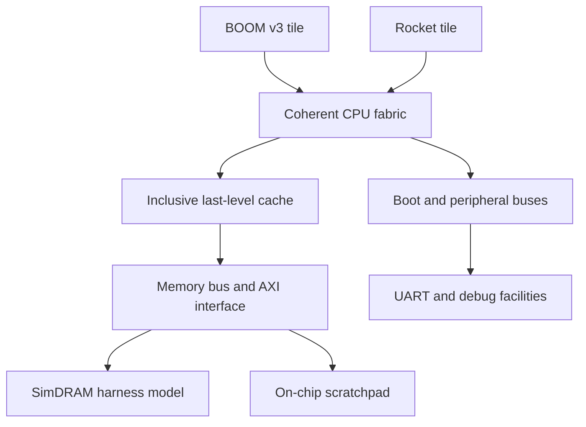

# NOVA-M1 system architecture

## Status and design intent

This is a design specification, not an implemented-chip report. The initial
NOVA configurations are thin derivatives of Chipyard source at
`a7946ede9bd625204435715dc40c750e2f8a251f`; their elaboration and execution remain
unverified until evidence is recorded in [STATUS](STATUS.md).

The long-term objective is an integrated RISC-V compute platform combining
heterogeneous CPUs, shared memory, AI acceleration, and graphics. “M-series-inspired”
describes system integration, not Apple affiliation, Arm/macOS compatibility,
proprietary microarchitecture replication, or equivalent performance per watt.

## Initial configuration contract

| NOVA profile | Exact upstream basis | Intended qualification |
| --- | --- | --- |
| `NovaM1BaselineConfig` | `RocketConfig` | Reproducible single-core baseline |
| `NovaM1MinimalConfig` | `LargeBoomAndRocketConfig` | Two-hart heterogeneous experiment |

[`RocketConfig`](../../generators/chipyard/src/main/scala/config/RocketConfigs.scala)
uses `WithNHugeCores(1)` and `AbstractConfig`.
[`LargeBoomAndRocketConfig`](../../generators/chipyard/src/main/scala/config/HeteroConfigs.scala)
composes `boom.v3.common.WithNLargeBooms(1)`,
`freechips.rocketchip.rocket.WithNHugeCores(1)`,
`WithSystemBusWidth(128)`, and `AbstractConfig`. These are reused upstream cores,
not newly designed NOVA CPU microarchitectures. BOOM v3 is the selected starting
point; moving to another generation requires a reviewed compatibility decision.

The mixed profile's Rocket is a large configuration. BOOM and Rocket are
performance-oriented and efficiency-oriented *candidate roles*, not a measured
P/E pair. Area, workload throughput, and energy evidence must establish any such
classification. A 128-bit system bus does not imply a measured DRAM bandwidth.

## Inherited baseline topology

The following logical view describes source-selected components of the mixed
profile. It omits adapters and detailed TileLink routing and does not substitute
for the elaborated hierarchy.

[`AbstractConfig`](../../generators/chipyard/src/main/scala/config/AbstractConfig.scala)
selects a coherent hierarchical bus topology, an inclusive last-level cache, one
AXI4 backing-memory channel, a 64-KiB memory-bus scratchpad, UART, boot-ROM
infrastructure, SerialTL loading, and debug/harness interfaces. Their availability
in source is not NOVA integration evidence.

The current harness selects `WithBlackBoxSimMem`, described in source as
SimDRAM. Record the actual instantiated model and its parameters in every run;
older upstream prose describing a single-cycle `SimAXIMem` is not authoritative
for this configuration. The AXI interface and simulation model are **not a
physical DDR/LPDDR controller or PHY**.

The inherited 500-MHz bus-frequency values are configuration inputs. They do not
establish achievable FPGA/ASIC clocks, timing closure, or operating power.

## Subsystem boundaries

| Boundary | Initial contract | Required evidence before extension |
| --- | --- | --- |
| CPU tiles ↔ fabric | Preserve inherited TileLink topology and configuration composition | Hart IDs, per-hart ISA/privilege capabilities, interrupts, reset, atomics, and coherence tests |
| Fabric ↔ memory | Preserve inclusive coherence infrastructure and one AXI channel | Generated map, model parameters, transaction ordering, backpressure, error and reset behavior |
| CPU ↔ AI accelerator | Gemmini/RoCC is a planned integration, not part of the initial profiles | Instruction routing, completion/error behavior, numerical correctness, and explicit memory-access contract |
| Fabric ↔ GPU/DMA | No integrated GPU or coherent DMA contract yet | Selected IP revision, adapters, ordering, buffer ownership, cache maintenance, isolation, and driver validation |
| Platform ↔ software | Inherited boot/debug mechanisms; NOVA firmware/Linux bring-up remains unverified | Reproducible boot artifacts, device-tree agreement, all-hart execution, and recovery tests |
| RTL ↔ physical platform | Simulation first; FPGA and ASIC mappings are separate targets | Board/process-specific memories, clocks, resets, I/O, constraints, and signoff evidence |

## Memory ownership and unified-memory research

CPU cache coherence, physical address sharing, shared virtual addressing, and
DMA isolation are separate properties. None may be inferred from the others.
Connecting GPU/NPU masters through AXI or allocating the same DRAM does not make
their private caches coherent with CPU caches.

Each accelerator integration must choose and document a coherent or noncoherent
access contract. A noncoherent contract requires explicit buffer ownership and
supported cache maintenance or uncached-buffer handling; an ordinary CPU fence
alone is not a cache flush. Coherent integration requires an appropriate protocol
participant plus dirty-line, eviction, atomic, ordering, and contention tests.
IOMMU support, per-process isolation, and shared virtual addressing remain
independent future requirements. See [MEMORY](MEMORY.md).

## Architectural invariants

1. Preserve upstream gitlink pins and source attribution; isolate NOVA additions.
2. Derive the definitive address map and device tree from each elaborated profile.
   Record region ownership, permissions, cacheability, alignment, reset behavior,
   and overlaps; do not freeze example addresses as a complete platform map.
3. Enumerate every hart and its actual ISA, MMU, interrupt, and cache parameters.
   Hart-0-only tests cannot qualify a heterogeneous machine.
4. Match software ISA/ABI and synchronization requirements to the participating
   cores. Boot success alone does not establish memory-ordering correctness.
5. Keep test harness models distinct from synthesizable chip logic and physical IP.
6. Specify timeout, error propagation, reset, and recovery at every new interface.
7. Separate source, RTL elaboration, simulation, FPGA, and silicon evidence levels.
   Claims must reference the exact profile and revision that were tested.

## Evolution and change control

The next architectural step is baseline execution, then mixed-core qualification.
Additional cores, cache banks, memory channels, Constellation topology, GPU,
Gemmini, media engines, and power domains are gated extensions—not features
enabled by this document. Scaling requires resource budgets, workload evidence,
interface review, and regression against the previous qualified profile.

Original NOVA work should be identifiable in architecture decisions, implementation
diffs, tests, and measured trade-offs. Parameter changes alone must not be described
as designing a new CPU. Changes to external interfaces, memory semantics, ISA
exposure, or dependency versions require review of hardware, firmware, drivers,
verification, and reproducibility impacts before adoption.

## Detailed specifications

- [CPU](CPU.md): core profiles, ISA/privilege contracts, and microarchitecture work.
- [Memory](MEMORY.md): address map, coherence, DMA, translation, and ordering.
- [Accelerators](ACCELERATORS.md): AI/GPU selection and hardware/software interfaces.
- [Platform](PLATFORM.md): boot, operating systems, interrupts, debug, and I/O.
- [Power and physical design](POWER_PHYSICAL.md): clocking, FPGA, and ASIC boundaries.
- [Verification](VERIFICATION.md): qualification gates, tests, and required evidence.
